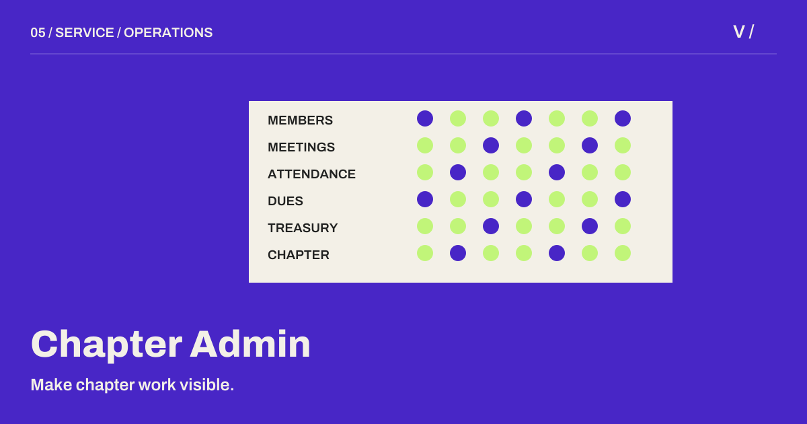

[← Back to the studio](../README.md#selected-work)

# Chapter Admin

**SERVICE / OPERATIONS** · Private source · public project narrative

A chapter administration workspace for membership, meetings, attendance and finances.

## The question

Chapter operations span people, recurring meetings and money. Separate records make it harder to maintain a shared operational view.

## The system

Role-based access and isolated chapter workspaces organize membership, meeting attendance, dues and treasury records in one application.

## Why it helps

Administrators can coordinate recurring chapter work with clearer records and explicit access boundaries.

## The craft

Next.js / TypeScript / PostgreSQL / Prisma

## Scope and evidence

Software workflow documented in the repository. Hardware attendance-device integration and measured deployment outcomes are not claimed.

This narrative is based on repository documentation reviewed on 27 October 2026. It describes the system and its intended value; it is not a new runtime test or a claim of measured business outcomes.

---

[Discuss a related project](mailto:vineeth@designinnsaeit.com) · [Explore the full project cabinet](../README.md#the-project-cabinet)
