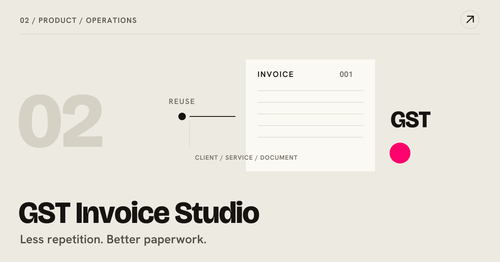

[← Back to the studio](../README.md#selected-work)

# GST Invoice Studio

**PRODUCT / OPERATIONS** · Private source · public project narrative

An India-focused workspace for invoices, purchase orders and reusable business records.

## The question

Small studios repeat the same client and service details across business documents, creating avoidable friction and inconsistency.

## The system

Reusable records feed document workflows, GST splits and A4 PDF output. Browser-local storage supports local work, with optional Supabase authentication and sync.

## Why it helps

Consultants and studios can prepare consistent paperwork with less repeated entry and clearer document structure.

## The craft

Next.js / TypeScript / document systems

## Scope and evidence

Repository-documented capabilities; tax settings and documents need business-specific review. No compliance certification is implied.

This narrative is based on repository documentation reviewed on 27 October 2026. It describes the system and its intended value; it is not a new runtime test or a claim of measured business outcomes.

---

[Discuss a related project](mailto:vineeth@designinnsaeit.com) · [Explore the full project cabinet](../README.md#the-project-cabinet)
