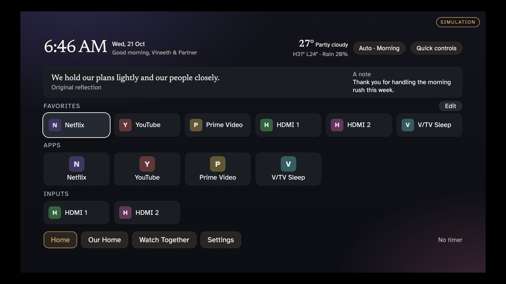

[← Back to the studio](../README.md#selected-work)

# V/HOME

**INTERACTION / CONNECTED HOME** · Public source

An ad-free LG webOS launcher designed around a shared living room.

## The question

A television is a shared, distant screen controlled with a remote. App access and household information need a different interaction rhythm from a desktop.

## The system

Favorites, folders, HDMI inputs, wallpaper and household information share one launcher. V/TV Sleep provides the timer; a phone companion extends control.

## Why it helps

Households can reach familiar apps and shared information from one intentional home screen.

## The craft

webOS / JavaScript / Python / remote-first UI

## Scope and evidence

Developer Mode required. Optional Home redirection is best-effort; model-specific behavior and setup limits are documented in the public repository.

This narrative is based on repository documentation reviewed on 27 October 2026. It describes the system and its intended value; it is not a new runtime test or a claim of measured business outcomes.

*Browser simulation, not a photograph of a television.*

[Public source and setup](https://github.com/vineeth-arch/v-home) · [V/TV Sleep](https://github.com/vineeth-arch/lgtv)

---

[Discuss a related project](mailto:vineeth@designinnsaeit.com) · [Explore the full project cabinet](../README.md#the-project-cabinet)
